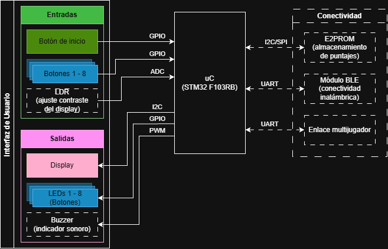
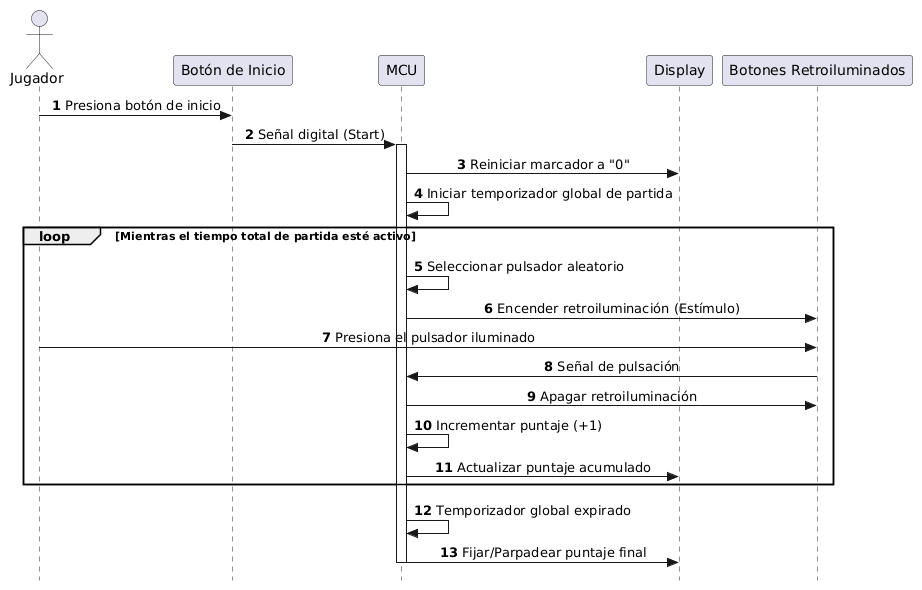
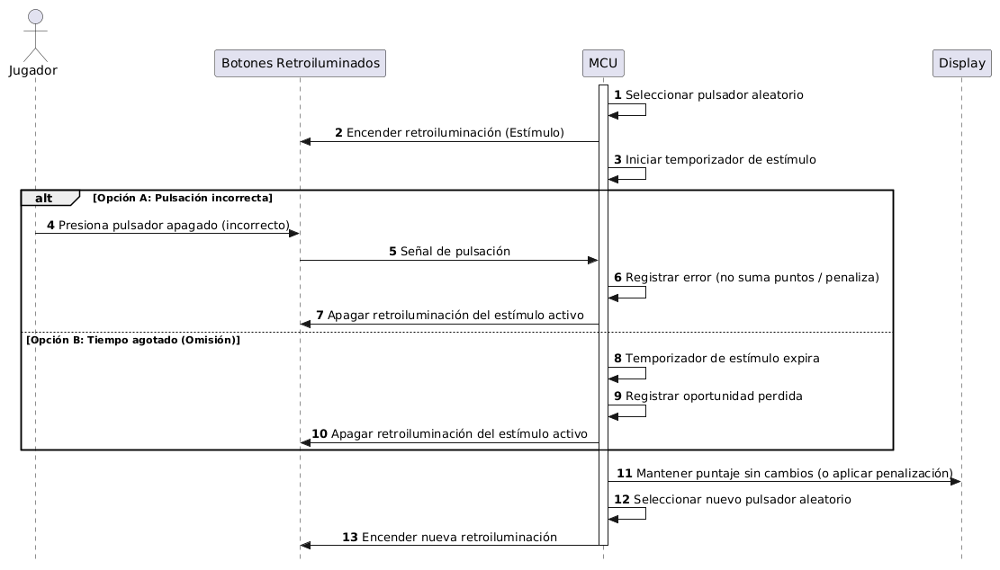
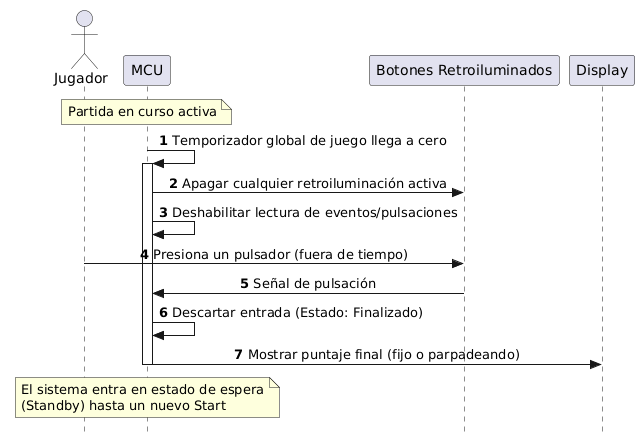

# **Juego de reflejos con pulsadores retroiluminados**

**Autores: Santander, Cristian; Flores Quiroga, Tobías; Itria, Franco**

**Padrones: 112.109; 111.546; 110.191**

**Fecha: 2do cuatrimestre 2026**

### **1. Selección del proyecto a implementar**

#### **1.1 Objetivo del proyecto y resultados esperados**

El objetivo de este proyecto es el desarrollo de un juego electrónico autónomo de destreza y velocidad de reacción, inspirado en la mecánica del clásico *Whack-A-Mole*. El sistema reemplazará los elementos mecánicos tradicionales por un conjunto de pulsadores retroiluminados distribuidos sobre un panel de juego.

El resultado esperado es un prototipo funcional (MVP) donde la dinámica se base en la activación aleatoria de los pulsadores mediante señales luminosas. El jugador deberá identificar el estímulo y presionarlo en el menor tiempo posible para acumular puntos, gestionando la dificultad a través de la velocidad de aparición y el tiempo máximo de respuesta. Al finalizar el tiempo disponible para la partida, el dispositivo mostrará automáticamente el puntaje total obtenido en un display digital, logrando una integración completa entre hardware y software mediante una aplicación interactiva e intuitiva.

#### **1.2 Proyectos similares**

Se consideran tres alternativas de implementación para cumplir con los objetivos del juego de reflejos:

1. **Juego de reflejos mecánico tradicional:** Basado en motores que eleven objetos que deberán ser golpeados físicamente.
2. **Juego electrónico básico sin display:** Utiliza LEDs y pulsadores simples, y no posee una pantalla para mostrar el puntaje, por lo que se indicaría el fin del juego con algún mecanismo básico, como puede ser un modo de iluminación de los mismos LEDs o un buzzer que emita sonido.
3. **Juego con pulsadores retroiluminados y display digital (MVP propuesto):** Utiliza una unidad de control que maneja la lógica de los actuadores, los cuales son botones arcade con iluminación integrada para los estímulos. Además se incluye un display digital para mostrar el puntaje en tiempo real.

Para comparar estas alternativas, se tienen en cuenta cinco aspectos característicos, ponderados del 1 al 10:

1. **Disponibilidad del hardware (9):** Facilidad para conseguir componentes en el mercado (microcontroladores, botones arcade, displays) frente a piezas mecánicas específicas.
2. **Calidad de la experiencia de juego (10):** El nivel de *feedback* visual y la claridad del objetivo y puntaje para el jugador.
3. **Escalabilidad del sistema (7):** Capacidad de futuras ampliaciones (multijugador, récords, conectividad).
4. **Dificultad técnica / Tiempo de implementación (8):** Balance entre el desafío de programación e integración electrónica y el tiempo disponible.
5. **Costo (6):** Presupuesto necesario para botones especiales, pantallas y fuentes de alimentación.

La siguiente tabla muestra los valores ponderados asignados a cada alternativa.

<table>
    <thead>
        <tr>
            <th rowspan="2">Criterio</th>
            <th colspan="2">Mecánico tradicional</th>
            <th colspan="2">Electrónico básico (sin display)</th>
            <th colspan="2">Retroiluminado y con display (Propuesto)</th>
        </tr>
        <tr>
            <th>Puntaje</th>
            <th>Puntaje Ponderado</th>
            <th>Puntaje</th>
            <th>Puntaje Ponderado</th>
            <th>Puntaje</th>
            <th>Puntaje Ponderado</th>
        </tr>
    </thead>
    <tbody>
        <tr>
            <td align="center">Disponibilidad de Hardware  (peso: 9)</td>
            <td align="center">4</td>
            <td align="center">36</td>
            <td align="center">10</td>
            <td align="center">90</td>
            <td align="center">9</td>
            <td align="center">81</td>
        </tr>
        <tr>
            <td align="center">Calidad de la experiencia  (peso: 10)</td>
            <td align="center">9</td>
            <td align="center">90</td>
            <td align="center">5</td>
            <td align="center">50</td>
            <td align="center">10</td>
            <td align="center">100</td>
        </tr>
        <tr>
            <td align="center">Escalabilidad del sistema  (peso: 7)</td>
            <td align="center">3</td>
            <td align="center">21</td>
            <td align="center">6</td>
            <td align="center">42</td>
            <td align="center">9</td>
            <td align="center">63</td>
        </tr>
        <tr>
            <td align="center">Dificultad técnica / Tiempo  (peso: 8)</td>
            <td align="center">3</td>
            <td align="center">24</td>
            <td align="center">9</td>
            <td align="center">72</td>
            <td align="center">8</td>
            <td align="center">64</td>
        </tr>
        <tr>
            <td align="center">Costo  (peso: 6)</td>
            <td align="center">4</td>
            <td align="center">24</td>
            <td align="center">9</td>
            <td align="center">54</td>
            <td align="center">7</td>
            <td align="center">42</td>
        </tr>
        <tr>
            <td align="center"><strong>Puntaje Total</strong></td>
            <td align="center">-</td>
            <td align="center">195</td>
            <td align="center">-</td>
            <td align="center">308</td>
            <td align="center">-</td>
            <td align="center"><strong>350</strong></td>
        </tr>
    </tbody>
</table>

<em>Tabla 1.2.1: Comparación de alternativas de proyecto.</em>

#### **1.3 Selección de proyecto**

Considerando la Tabla 1.2.1, se decide avanzar con la implementación del **Juego con pulsadores retroiluminados y display digital**. La variante mecánica tradicional presenta graves problemas de disponibilidad de hardware a nivel local y tiempos de implementación excesivos debido al desgaste de partes móviles. Por otro lado, la versión electrónica básica limita severamente la experiencia de usuario al no brindar métricas claras del desempeño.

El proyecto seleccionado ofrece el balance perfecto: utiliza componentes electrónicos estándar fácilmente asequibles (sobre todo considerando que se comprarán vía sitios nacionales para minimizar tiempos de envío), proporciona una interfaz visual más cómoda para el usuario a través del display y los botones retroiluminados, y establece una arquitectura controlada por una unidad central que escala fácilmente hacia futuras etapas (como conectividad, modos multijugador o almacenamiento de récords, los cuales quedan fuera del alcance inicial).

###### **1.3.1 Diagrama en bloques**

En la Figura 1.3.1 se muestra el diagrama en bloques del sistema con los principales módulos del proyecto.

	

<em>Figura 1.3.1: Diagrama de bloques del sistema.</em>

Los bloques trazados en línea de puntos representan elementos no contemplados en el diseño del MVP pero se planea implementarlos en caso de disponer del tiempo suficiente para hacerlo. 

---

### **2. Elicitación de requisitos y casos de uso**

En el mercado del entretenimiento existen múltiples máquinas tipo arcade o juguetes domésticos orientados a la velocidad de reacción. Competidores como las máquinas de *Whack-A-Mole* comerciales de gran formato ofrecen una experiencia robusta, pero son costosas, pesadas y cerradas a cualquier tipo de modificación o reprogramación.

Por otro lado, existen aplicaciones móviles que simulan esta mecánica en pantallas táctiles, pero carecen completamente del estímulo físico e inmersivo que proporciona golpear un botón real retroiluminado. Este proyecto se posiciona como una solución intermedia: un prototipo físico tangible, de funcionamiento intuitivo, que integra lógica programable y periféricos electrónicos, ideal para demostrar la integración de hardware y software en un dispositivo autónomo de escritorio.

#### **2.1 Requisitos del proyecto**

En la Tabla 2.1 se detallan los principales requisitos funcionales del sistema basados en el alcance del MVP.

| Grupo | ID | Descripción |
| --- | --- | --- |
| Lógica y Control | 1.1 | El sistema contará con una unidad de control que seleccionará de forma aleatoria qué pulsador debe activarse. |
|  | 1.2 | El sistema gestionará la velocidad de aparición de los estímulos y el tiempo máximo de respuesta para determinar la dificultad. |
|  | 1.3 | El inicio y finalización de las partidas se realizará de forma automática en base a un tiempo de juego preestablecido. |
| Interfaz de Usuario | 2.1 | El panel de juego estará compuesto por pulsadores físicos que incluirán indicadores luminosos para identificar el estímulo activo. |
|  | 2.2 | El sistema contará con un pulsador de inicio dedicado exclusivamente para habilitar una nueva secuencia de juego. |
|  | 2.3 | Se incorporará un display digital que mostrará el puntaje acumulado durante la partida y el resultado al finalizar. |
| Puntuación y Reglas | 3.1 | Si el jugador presiona el pulsador iluminado en el tiempo establecido, el sistema registrará una "Respuesta correcta" y sumará un punto. |
|  | 3.2 | Si el jugador presiona un pulsador apagado, el sistema registrará una "Respuesta incorrecta" (no suma puntos, posible penalización). |
|  | 3.3 | Si se agota el intervalo del estímulo sin respuesta, la oportunidad se pierde y el sistema genera una nueva secuencia luminosa. |
| Energía | 4.1 | El sistema de alimentación proporcionará las tensiones necesarias y estables para la unidad de control, los LEDs de los pulsadores y el display. |

<em>Tabla 2.1: Requisitos funcionales del MVP.</em>

En las Tablas 2.2 a 2.4 se presentan 3 casos de uso para el sistema.

#### **2.2 Caso de uso 1: El usuario inicia y juega una partida**

| Elemento            | Definición                                                                                                                                                                                                                                                                                                                                                                                                                                                   |
| ------------------- | ------------------------------------------------------------------------------------------------------------------------------------------------------------------------------------------------------------------------------------------------------------------------------------------------------------------------------------------------------------------------------------------------------------------------------------------------------------ |
| Disparador          | El jugador presiona el "pulsador de inicio" para comenzar a jugar.                                                                                                                                                                                                                                                                                                                                                                                           |
| Precondiciones      | El sistema está encendido y alimentado. No hay ninguna partida en curso. El marcador en el display digital se encuentra en cero o mostrando el puntaje anterior.                                                                                                                                                                                                                                                                                             |
| Flujo principal     | El jugador presiona el botón de inicio. La unidad de control reinicia el display digital a "0" y arranca el temporizador de la partida. El sistema selecciona un pulsador aleatorio y enciende su retroiluminación. El jugador identifica la luz y lo presiona rápidamente. El sistema detecta la pulsación, apaga la luz, suma un punto en el display y repite el ciclo generando un nuevo estímulo aleatorio hasta que se agote el tiempo total del juego. |
| Flujos alternativos | a) El jugador presiona el botón de inicio mientras una partida ya está en curso: El sistema ignora el comando para evitar reinicios accidentales.                                                                                                                                                                                                                                                                                                            |

<em>Tabla 2.2: Primer caso de uso.</em>

	

<em>Figura 2.2: Diagrama de secuencias del primer caso de uso.</em>

#### **2.3 Caso de uso 2: El jugador comete un error (Respuesta incorrecta u Omisión)**

| Elemento            | Definición                                                                                                                                                                                                                                                                                                       |
| ------------------- | ---------------------------------------------------------------------------------------------------------------------------------------------------------------------------------------------------------------------------------------------------------------------------------------------------------------- |
| Disparador          | El jugador (a) presiona un botón equivocado o (b) no llega a presionar el botón a tiempo.                                                                                                                                                                                                                        |
| Precondiciones      | Una partida se encuentra en curso. Un pulsador específico está actualmente iluminado esperando interacción.                                                                                                                                                                                                      |
| Flujo principal     | El jugador presiona un pulsador que no es el que se encuentra iluminado. El sistema detecta la lectura inválida, registra el error, no suma ningún punto al marcador (y aplica penalización interna si está configurada), apaga el estímulo actual y genera inmediatamente uno nuevo para continuar la dinámica. |
| Flujos alternativos | a) Tiempo agotado: El jugador no presiona ningún botón y el tiempo asignado al estímulo expira. El sistema apaga el botón iluminado, considera la oportunidad perdida (sin sumar puntos) y enciende uno nuevo.                                                                                                   |

<em>Tabla 2.3: Segundo caso de uso.</em>

	

<em>Figura 2.3: Diagrama de secuencias del segundo caso de uso.</em>

#### **2.4 Caso de uso 3: Finalización automática de la partida**

| Elemento            | Definición                                                                                                                                                                                                                                                                                                                                                                                                                                                                        |
| ------------------- | --------------------------------------------------------------------------------------------------------------------------------------------------------------------------------------------------------------------------------------------------------------------------------------------------------------------------------------------------------------------------------------------------------------------------------------------------------------------------------- |
| Disparador          | El temporizador global de la partida llega a su fin.                                                                                                                                                                                                                                                                                                                                                                                                                              |
| Precondiciones      | El jugador está en medio de una partida, respondiendo a los estímulos.                                                                                                                                                                                                                                                                                                                                                                                                            |
| Flujo principal     | El tiempo total establecido para la partida se agota. La unidad de control detiene inmediatamente la generación de nuevos estímulos aleatorios y apaga cualquier pulsador que se encuentre iluminado. El sistema bloquea el registro de nuevas pulsaciones y el display digital parpadea o mantiene fijo el puntaje final acumulado para que el jugador pueda visualizar su desempeño. El sistema queda en estado de espera hasta que se vuelva a accionar el pulsador de inicio. |
| Flujos alternativos | a) El jugador presiona un botón milisegundos después de que termine el tiempo: La unidad de control descarta la entrada ya que el estado del juego pasó a "finalizado".                                                                                                                                                                                                                                                                                                           |

<em>Tabla 2.4: Tercer caso de uso.</em>

	

<em>Figura 2.4: Diagrama de secuencias del tercer caso de uso.</em>

